In my previous post on [my software engineering approach](/2024/11/20/joes-lightweight-software-engineering-approach/) I talked about the various feedback mechanisms that can be used to get better outcomes, ranging from the user feedback loop, right down to the coding practices. However, that post is very light on details about the various activities that could be used to manage the process. This post will touch upon what I think are some valuable practices, and the appropriate cadence of using these practices.

I'm a bit a process magpie - I'll pick up techniques and practices from different sources. All the techniques I reference below are based on ways to shorten feedback loops. This post assumes you're starting from scratch, although any existing organisation will certainly have a set of practices already in place, in which case you choose to adapt existing processes to things which help with improving feedback loops.

**Table of Contents**

1. [Base Principles](#base-principles)
2. [Setting Strategy and Goals](#setting-strategy-and-goals)
3. [Making a Roadmap](#making-a-roadmap)
4. [Impact Mapping](#impact-mapping)
5. [Building a Kanban Board](#building-a-kanban-board)
6. [Using the Kanban Board](#using-the-kanban-board)
7. [Estimating Epics](#estimating-epics)
8. [Breaking Down Stories and Spikes](#breaking-down-stories-and-spikes)
9. [Tracking Progress](#tracking-progress)
10. [Meeting Schedules](#meeting-schedules)

## Base Principles

There are a couple of principles that lead to highly effective organisations: aligned autonomy, and the work-feedback loop.

### Aligned Autonomy

A lot of the advice in this post is aimed at achieving _aligned autonomy_.
- _Alignment_ is having a shared purpose. When teams are aligned, all teams are pursuing the same goal
- _Autonomy_ is the capacity for teams to make decisions independent of others and senior leadership.
- _Aligned Autonomy_ allows for organisations to be much more reactive, and able to achieve better outcomes.

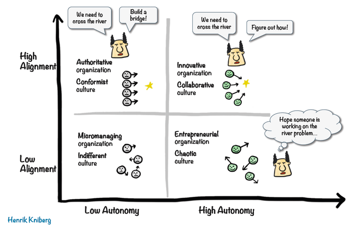

Henrik Kniberg wrote about this in 2012, which is a little dated. There is a very good write up of a modern take of this idea at [https://www.scrum.org/resources/blog/knibergs-aligned-autonomy-matrix-still-relevant](https://www.scrum.org/resources/blog/knibergs-aligned-autonomy-matrix-still-relevant), which brings in concepts from Team Topologies and modern organisational design.

The following details are all ways of improving alignment through all layers of the organisation.

### Work-Feedback Loop

We are aiming to support a learning organisation, but focusing on the work-feedback loop. Quoting from [https://no-bullshit-agile.com/wfl/](https://no-bullshit-agile.com/wfl/):

> Work → Feedback → Decision → Future Work
> 
> A system only learns reliably from reality if six conditions are met:
> 
> 1. **Work** creates a real effect (not just internal activity),
> 1. the work is guided by a **guiding intent**—an expectation of what effect it should produce,
> 1. the effect becomes visible as **feedback** (as a signal, not an opinion),
> 1. the signal is compared against the **guiding intent**,
> 1. this leads to a **decision** (priorities/assumptions/resources change),
> 1. and that decision changes **future work**.
> 
> Ultimately, an effective work-feedback loop leads to a highly effective learning organisation.

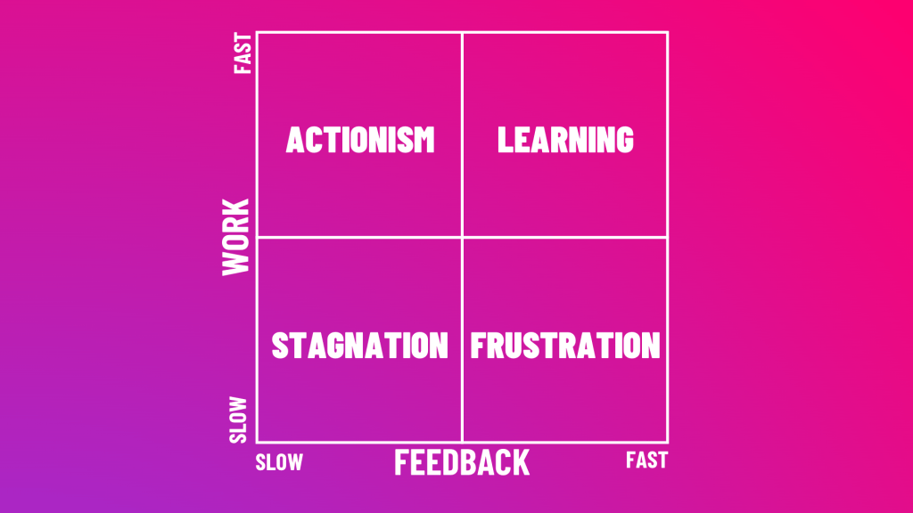

## Setting Strategy and Goals

Before getting on to goals, an organisation needs to decide where it wants to focus it's resources. There are two concepts I like to look at when doing this: the hedgehog concept, and Wardley mapping. The first helps an organisation decide where to play, and the second give the organisation strategic orientation.

The Hedgehog Concept is important for an organisation to assess its own capabilities. Jim Collins wrote about it in his book _Good to Great_ (see [https://www.jimcollins.com/concepts/the-hedgehog-concept.html](https://www.jimcollins.com/concepts/the-hedgehog-concept.html)).

> A Hedgehog Concept is not a goal to be the best, a strategy to be the best, an intention to be the best, a plan to be the best. It is an understanding of what you can be the best at. The distinction is absolutely crucial.

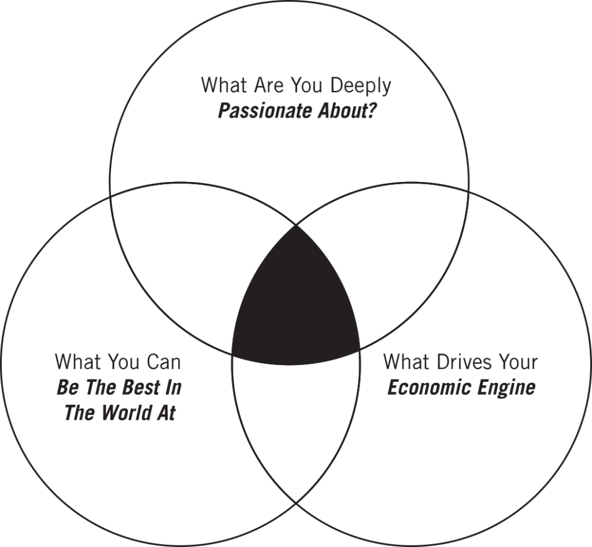

If you don't already have one, having an explicit statement of your organisations' area of where you can be the best can be a valuable exercise.

Having decided where to play, an organisation needs to decide on how to play the game to win. Here, [Wardley Mapping](https://medium.com/wardleymaps) gives a distinct advantage. It allows players to see the competitive landscape in a way most organisations are not even aware of, and allows for evolution, climate, doctrine, and possible moves.

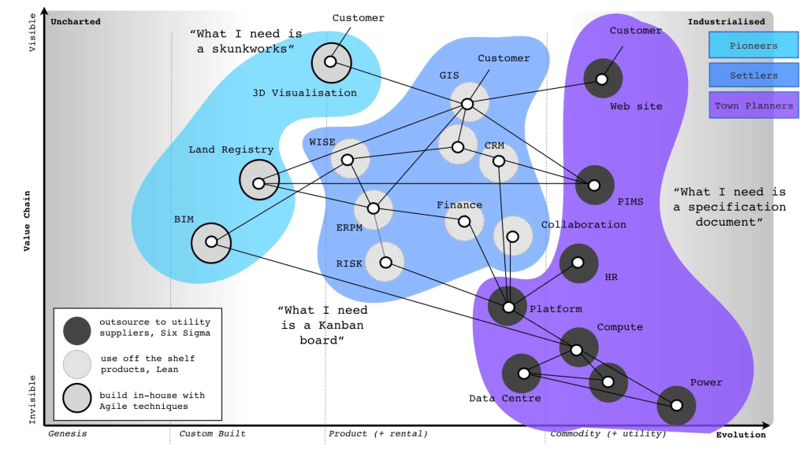

Given a strategic direction, John Cutler has a lot of advice on managing the strategic feedback loop (he also has a huge amount of other organisational level product management advice on his blog at [The Beautiful Mess](https://cutlefish.substack.com/)). John Cutler's [data informed product cycle](https://cutlefish.substack.com/p/tbm-852-the-data-informed-product) gives clear guidance on how to decide on next steps.

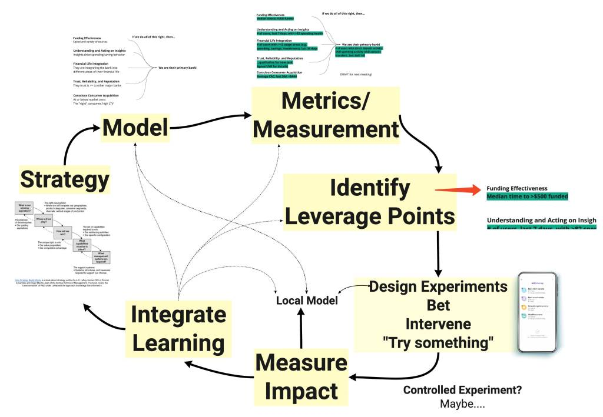

## Making a Roadmap

Roadmaps are tricky things. It can be hard to create, and then having an item on a roadmap can be treated like a commitment or promise. Once again, John Cutler has some good advice in his guidance on [suitably detailed roadmap items](https://cutlefish.substack.com/p/tbm-41b52-suitably-detailed-roadmap):

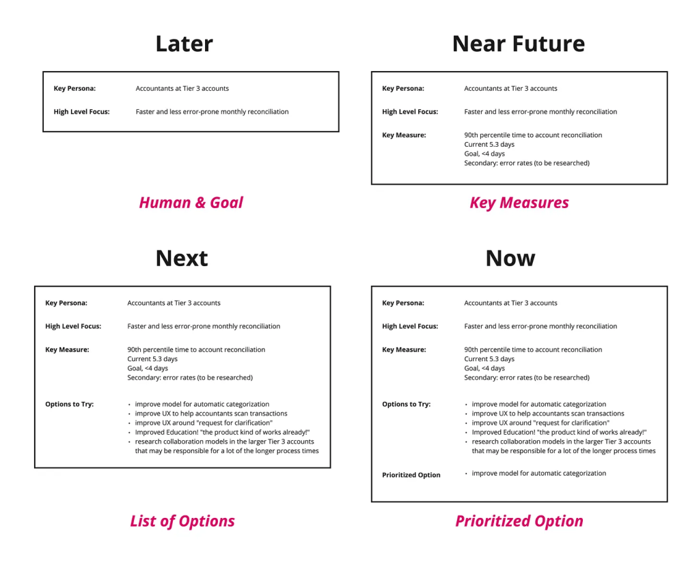

Each of the items in the roadmap should have a clear linkage to items on the impact map. For example, the "Key Persona" ties directly into the "Actor" in the impact map above. The "High Level Focus" should tie in directly with an impact.

How often should the roadmap be updated? Many organisations do it monthly, or quarterly. John Cutler has some more good advice: [continuous roadmapping](https://cutlefish.substack.com/p/tbm-2152-continuous-roadmapping). As completed roadmap items move off the board, you immediately add in a new option.

> The important point here is that we try to keep this board filled at all times with eight cards. Eight cards! That's manageable. As new information becomes available, we swap in cards as necessary.

Further references:

- [https://cutlefish.substack.com/p/tbm-4853-one-roadmap](https://cutlefish.substack.com/p/tbm-4853-one-roadmap)
- [https://cutlefish.substack.com/p/tbm-1952-a-portfolio-of-bets](https://cutlefish.substack.com/p/tbm-1952-a-portfolio-of-bets)
- [https://cutlefish.substack.com/p/tbm-218-level-depth-time-and-frame](https://cutlefish.substack.com/p/tbm-218-level-depth-time-and-frame)
- [https://medium.com/@johnpcutler/hybrid-boards-for-roadmapping-736a0514d3d8](https://medium.com/@johnpcutler/hybrid-boards-for-roadmapping-736a0514d3d8)

## Impact Mapping

Given a strategy and direction (from Wardley Mapping), and experiments to run (from the data informed product cycle), and a prioritised option (from the roadmap), we still need to work out how to bridge the high level to the actual concrete implementation steps. For this, I really like impact maps.

Quoting from [https://www.impactmapping.org/drawing.html](https://www.impactmapping.org/drawing.html)

> An impact map is a visualisation of scope and underlying assumptions, created collaboratively by senior technical and business people. It is a mind-map grown during a discussion facilitated by considering the following four aspects:
> 
> **Goal**: The centre of an impact map answers the most important question: Why are we doing this? This is the goal we are trying to achieve.
> 
> **Actors**: The first branch of an impact map provides answers to the following questions: Who can produce the desired effect? Who can obstruct it? Who are the consumers or users of our product? Who will be impacted by it? These are the actors who can influence the outcome.
> 
> **Impacts**: The second branch level of an impact map sets the actors in the perspective of our business goal. It answers the following questions: How should our actors’ behaviour change? How can they help us to achieve the goal? How can they obstruct or prevent us from succeeding? These are the impacts that we’re trying to create.
> 
> **Deliverables**: Once we have the first three questions answered, we can talk about scope. The third branch level of an impact map answers the following question: What can we do, as an organisation or a delivery team, to support the required impacts? These are the deliverables, software features and organisational activities.

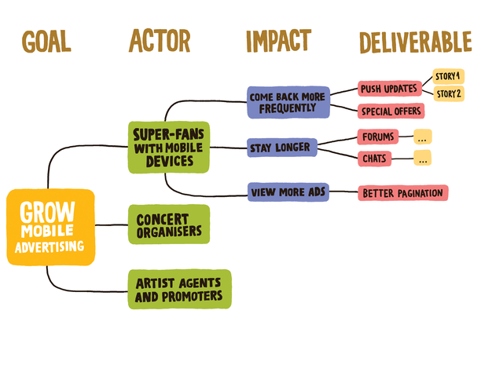

I think it's always a good idea to attach some sort of metrics to goals and impacts. It should be very clear how the goal is going to be measured, and if the deliverables are making real progress on shifting the behaviour of the actor.

A good way to create an impact map is to run a workshop. See [https://github.com/impactmapping/open-impact-mapping-workshop](https://github.com/impactmapping/open-impact-mapping-workshop) for an example on how to do this.

A good cadence to do impact mapping is every quarter, or when goals change significantly. In practice there is also a feedback loop between building a roadmap, building an impact map, and prioritising work as described in the engineering approach. Changes to priorities will often trigger a remapping as new actors or impact become relevant to upcoming roadmap items.

## Building a Kanban Board

The key to a good kanban board is its ability to act as an information radiator. I like to think a kanban board is doing its job if an interested bystander (e.g. CEO, VP product, etc) can look at the board and understand:

- What's the goal that you're working on?
- What are the actors and impacts?
- What are the prioritised epics?
- What stories are currently being worked on?
- When will it be done?
- What will be done next?

It's hard to get all of that information from a single board, but you can get close. For those with a physical board, I find it much easier to do this. Electronic boards (e.g. Jira) make it much more difficult, although there are things you can do to help.

In building the board, I try to mirror, as close as possibly, the information derived from the impact mapping exercise. This provides a direct and concrete link between details all the way up to the goal(s). i.e. Story ⇒ Epic ⇒ Impact ⇒ Actor ⇒ Goal

Goal (or goals) should be visible somewhere, written in a sentence or two, with key measures.

Actors/personas should be identified and written down, with a sentence or two.

The real work comes in the epics. One hard rule I use: every epic should be limited to a single impact (with a corresponding actor). If the same actor has different impacts, put them in different epics. If it's a different actor, different epic. This constraint makes it _very_ clear who the target of the user stories is, and who is needed to close the engineering feedback loop.

On the kanban board, each epic becomes a swimlane. Higher priority epics go at the top of the board, lower priority epics go lower. This means the priority of any work becomes obvious.

The columns in the kanban will reflect you engineering process. Stories and spikes should be represented as cards on the board, placed in the appropriate swimlane and column. If your process is not well-defined, a good starter set of columns would look something like:

- **Backlog**. I often leave this column out, but you can put in ideas for work if you want to keep track of upcoming work.
- **Prioritised**. The team has agreed that the feature should be started iminently.
- **Ready for Development**. The work has been analysed, acceptance criteria agreed, and can be pulled into development when ready. In essence, the "definition of ready" criteria have been met.
- **In Development**. The development team is working on the story or spike right now. "Working" in this context means coding, testing, reviewing, and all the other things that are involved in completing the work to an acceptable standard.
- **Development Complete**, **Ready to Deploy**. All work on the story or spike has been completed. It has met the "definition of done". The code has been merged into the main development branch, artefacts have been built, but has not yet been deployed to production. For organisations that only deploy in small windows of time, this column may have a large number of stories. However, a better approach is to deploy to production as soon as the story has passed all the acceptance criteria.
- **Ready for Demo**. I don't always use this, but organisations that use demos to showcase their work to stakeholders can use this to track what the demo will cover. I do think it's a mistake to wait until demo to deploy to production, though (see the notes on the "Ready to Deploy" column)
- **In Production**. The feature has been deployed onto production servers.
- **In Use**. The feature has been shown to have been used by at least one user.

Some other columns I often see (but prefer not to use myself):

- **Coding**, **Review**, **Waiting for Review**. Many organisations prefer to split the "In Development" column into these extra columns. I prefer to avoid these internal development states, as it makes it hard to see the current work in progress, and can give team informal permission to pull more work into "In Development", even if it is not fully complete.
- **User Acceptance Testing**, **Performance Testing**. Many organisations add these states after "Development Complete". My personal preference is to avoid these states if possible. Preferably, use acceptance criteria should be discussed and defined up front when the story is prioritised, and automated tests built to cover those scenarios. Not all organisations have that level of trust in the engineering team, though - which is it's own issue.

[The Phoenix Project book](https://itrevolution.com/product/the-phoenix-project/) describes 4 types of work:

- Business Projects
- Internal Projects
- Changes
- Unplanned Work

All this work needs to be represented on the board. Business projects are normally accounted for in the process described above. Internal IT projects, may use different prioritisation, or fit in with the other projects. One red flag to watch for - if all prioritised work is only business projects. For organisations with non-technical leadership, internal IT projects or changes may not be understood, and are not prioritised. This could be back end maintenance, technology uplift, technical debt improvement, research projects. These should all be represented on the board, with clear goals, actors (these can be internal actors), and impacts.

The last point is "unplanned work". This is emergency work that must be done. I always keep an epic open at the top of the board for this work. Be careful not to put all random bits of work in that epic - make sure it really is an emergency. For example - if a bug is discovered late, it could be an emergency "fix it now!" problem, or the product owner could decide to prioritise it later, in which case it goes into to epic most closely associated with the impact of the bug.

Here's an example of what the board might look like:

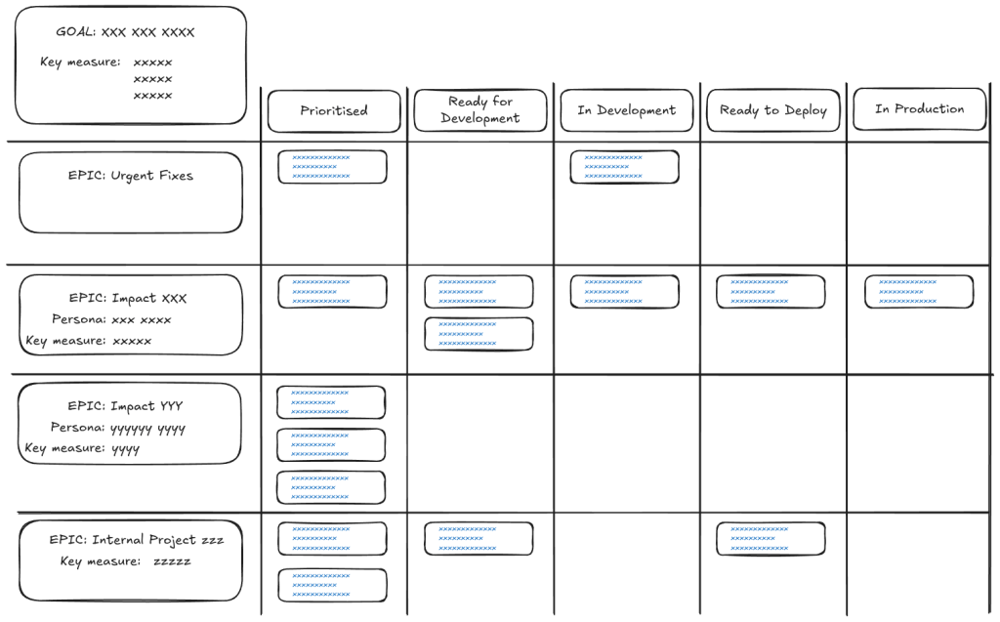

## Using the Kanban Board

The team can choose the amount of concurrent work that it will accept. This is expressed a limit on the work in progress (a.k.a. WIP Limit). For teams that mandate pair programming, the WIP limit for "In Development" work will be less than the number of developers.

The team may also decide if they are going to swarm on a single epic, or alternatively spread their work over multiple epics. This will be agreed up front, and everyone should be aware of this working agreement. I'm going to go over an example of how a team member would pick up new work on this board. The team working agreement is that there is one business epic and one internal project active.

In this scenario team member "Joe" turns up to work without an existing task. Joe looks at the board. The general rule is priority goes from top to bottom (higher priority work appears at the top of the board - epics are in priority order, and stories within columns are also in priority order). Additionally, priority goes from right to left. A task that is not yet complete always as higher priority than tasks to the left.

In this example, "Urgent Fixes" is the highest priority epic, so Joe starts there. Looking from right to left, there is one task currently "In Development". This is the first place to look.

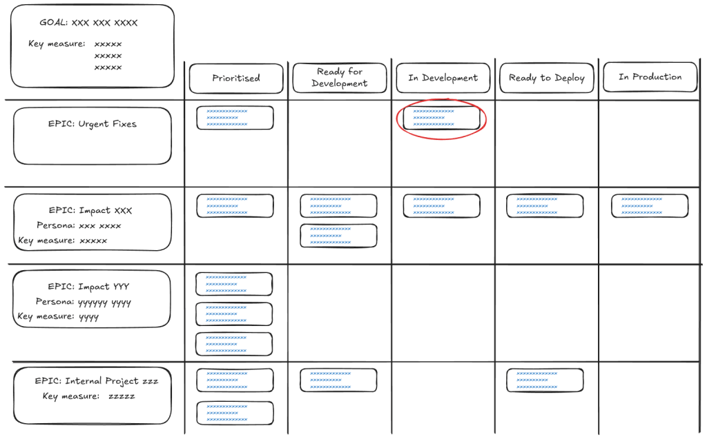

This work is already in progress, but it is still the highest priority, and Joe starts there. He finds the team members currently working on that task to see if they need help. After a brief discussion with the pair, Joe determines that they don't need further help, so Joe looks at the next highest priority task. This is the "Prioritised" task in "Urgent Fixes"

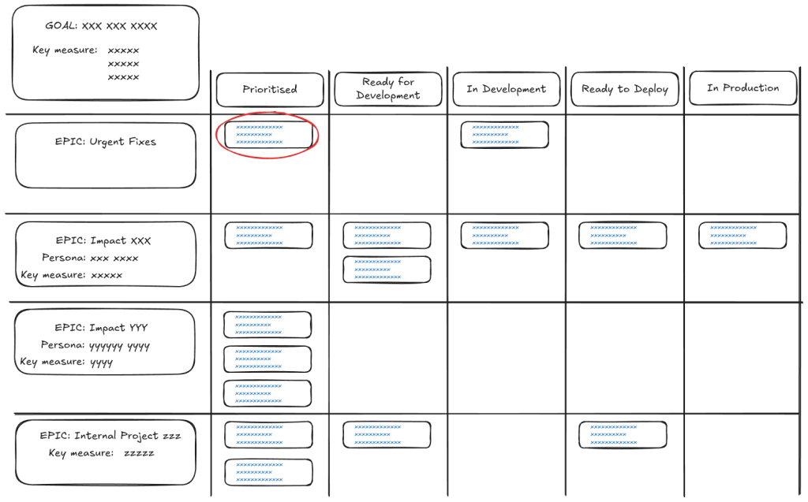

This task hasn't been fully curated yet. The pull based kanban approach means that this card now needs to be "pulled" into the "Ready for Development" column. "Urgent Fixes" are in that epic because thet really are urgent, and take priority over other work that the team may be doing. This high priority means that Joe must interrupt other team members from their work in order to properly curate the task. In general interruptions like these should be avoided, but high priority work is always unpredictable. If the work wasn't really urgent, it would be moved down into one of the lower priority epics.

After a quick 15 minute discussion with other team members, the acceptance criteria for the task are agreed, the card is updated, and pulled directly into the "In Development" column, and Joe starts work on it, remaining on it for the rest of the day.

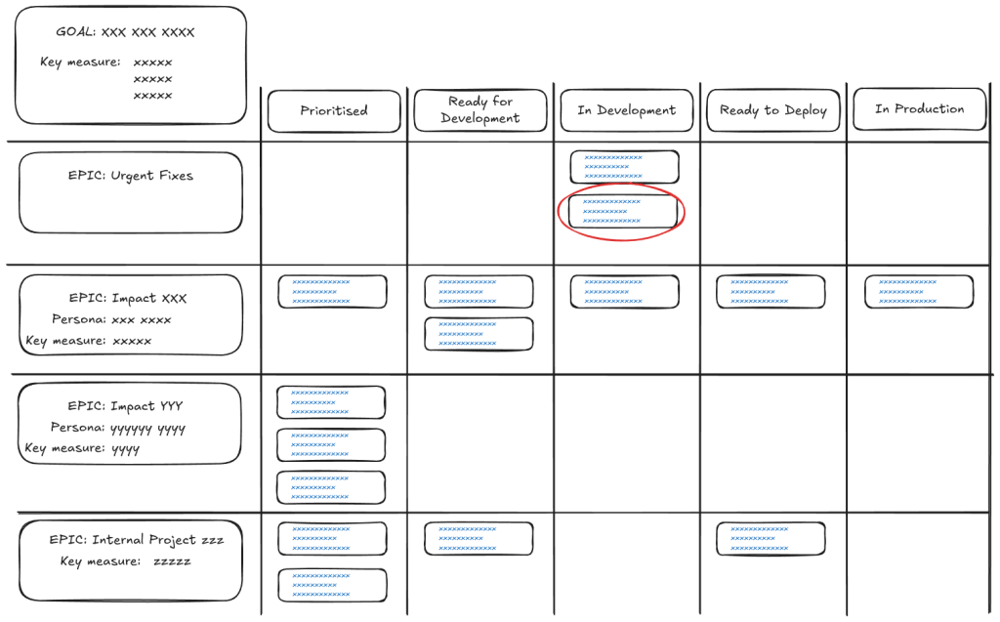

The next day Joe returns to work. There are no more urgent fixes. Once again, Joe checks with the developers currently working on the only "In Development" task for the "Impact XXX" epic. They do not need help, so Joe selects the next highest priority task at the top of the "Ready for Development" column.

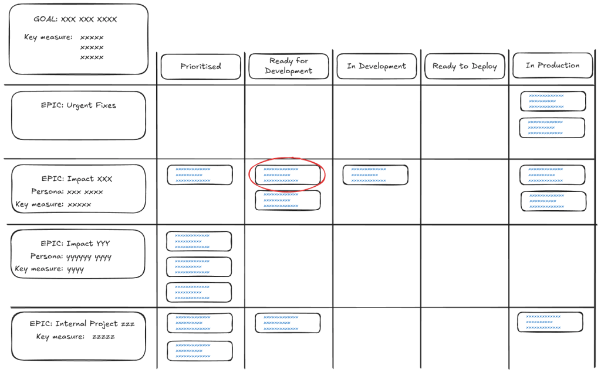

At the same time, Joe's team mate Emily is also looking for work. In consultation with the team, they decide that enough effort is going into the "Impact XXX" epic. As per the team working agreement, the team wants to ensure that some effort is put into the "Internal Project ZZZ" epic. Although this is an inversion of priority, the team in ensuring that some capacity is reserved for internal projects. Other organisations might have more explicit ways of prioritising internal projects, but in this example organisation that is not in place. Emily chooses the "Ready for Development" task in the "Internal Project ZZZ" epic. After moving the tasks to the appropriate column, the board now looks like this:

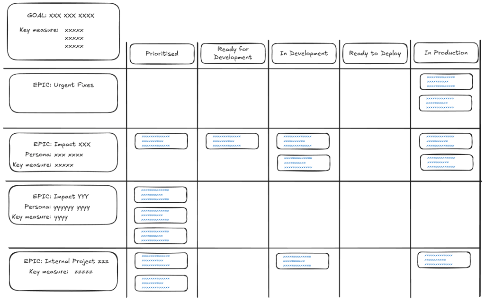

The WIP is currently 3, with ⅔ of the team effort focused on business priorities, and ⅓ focused on internal projects. Work on the "Impact YYY" epic will begin after all the work on the "Impact XXX" epic has completed, or the team decides to change the priorities or working agreements.

In practice there are a lot more nuances to consider. Not everyone in the team may have the skills to complete a specific task, or there are other blocking issues or dependencies which means tasks may be selected out of pure priority order.

## Estimating Epics

Estimation is fractal. The closer you look at a piece of work, the more details you can discover. Until you've broken the work down into small enough pieces, the total amount of work is uncertain. On the other hand, if you spend a lot of time getting a very accurate estimate, you've probably had to break down the work to such a small degree that any change the to plans will make the estimates invalid.

There's a good middle ground: [Blink Estimation](https://dannorth.net/blog/blink-estimation/). As described by Dan North, blink estimation allows you quickly get a good enough sense of the size of the work to allow for priortisation or investment decisions without getting bogged down in details. The process is roughly this:

- Get everyone with some skin in the game into a room
- Talk about the goals, outcomes, implementation options, integration needs, and anything else that is relevant
- Everyone secretly writes an estimate on a card
- At the count of 3, all estimates are all revealed at the same time
- Discuss the outliers (why so big? why so small?)
- Record the estimate

## Breaking Down Stories and Spikes

Breaking down work out of an epic also involves estimation, but in a more focused way. Essentially, the team needs to break down stories or spikes to a point where they estimate that they're "small enough".

When starting work on an epic, a team may be tempted to fully break down the work in one big session. This is not a good idea. Dan North mentions this in his piece on blink estimation:

> Breaking things down to story level is one way of exploring a space, and can lead to some good discoveries, but it is far from the best approach to surfacing uncertainty. If it were, all agile projects would contain no surprises because they would all have emerged during the backlog creation. Except that means we’ve just reinvented big, up-front analysis and design!

Instead, the team discusses the biggest risks, uncertainties, and unknowns in the work that needs to be done, and proposes stories or spikes that can be done earliest to reduce the risk. Some of these are prioritised, and then the team will estimate the size of the work. I really like [Lunar Logic's planning poker cards](https://estimation.lunarlogic.io/). The options are:

- 1 (the story/spike is correctly sized)
- TFB (the story is too big - keep on breaking it down into smaller tasks)
- NFC (you don't know enough to properly estimate - break out a spike to explore)

My advice is that "correctly sized" is around 1 "ideal developer pair day". That is, with no interruptions, a pair can code, test, review, and merge the feature into the main branch in a single day. Of course, ideal developer days can be rare in some organisations (too many meetings, administration, and other distractions!). This means stories can often take longer than a day to complete, but this can be tracked in stand-ups.

## Tracking Progress

Stakeholders always want to know when they will get their goodies. Although nothing is certain in life, it is possible to give a prediction of likely time frames, based on the epic estimates, and tracking progress over time.

I track progress for each epic, although tracking multiple epics will work exactly the same.

The process goes something like this for each epic:

- Estimate the total size of the epic, in total stories or spikes (see the blink estimation technique above)
- Every day, track the number of completed stories or spikes (keep track of in-progress issues, too)
- Run a linear regression against the completed issues for the recent days (I tend to use about 2 weeks)
- Plot the regression forward to find where it crosses the total issues count. That's your prediction.

Noting that team velocity is rarely constant, I usually tweak this to calculate the regression slope over a two-week period. The flattest slope gives you a pessimistic prediction, while the steepest slope gives you the optimistic prediction.

It's easier to see this when plotting on a chart (this is called a cumulative flow diagram):

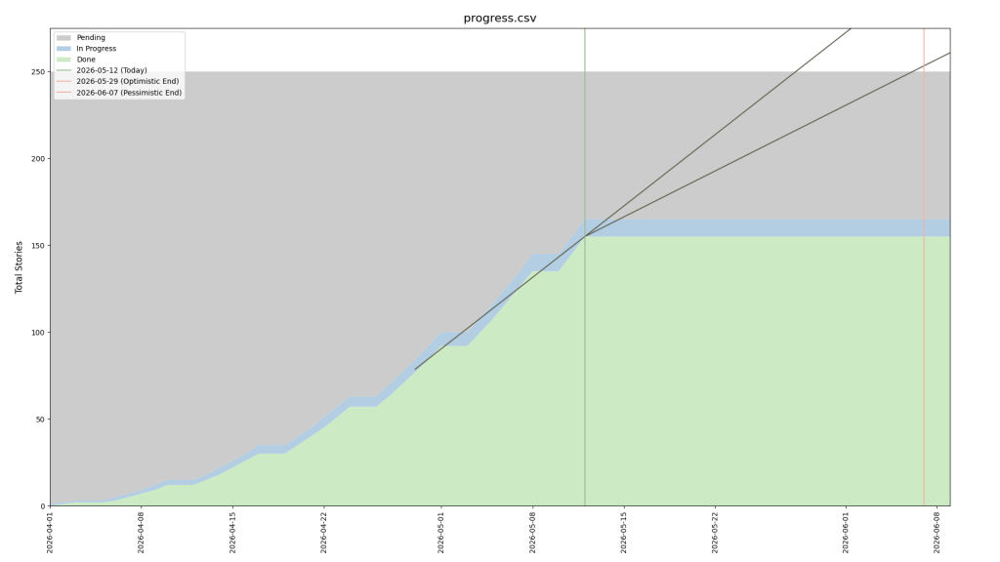

This chart is created using [https://github.com/tumbarumba/issue-tracker-tools](https://github.com/tumbarumba/issue-tracker-tools). You can read the predicted optimistic and pessimistic completion dates right off the chart.

Note that this is only as good as the data that you feed into it. A key practices is to regularly revisit the total size of the epic (or more easily - how much left). You will find that the more you implement, the better idea of the remaining work the team will have. In the chart, this will be seen as a change to the total scope (the top line). Sometimes you discover the epic is much bigger than expected (or much smaller!). This technique allows you to visualise the impact of the updated learning.

The predictions should be used to make investment decisions:

- Continue on this epic? Or stop and start something else that has a better chance of succeeding?
- Descope some scope to allow a deadline to be hit?
- Add in more features?

## Meeting Schedules

Putting all the above principles together into a schedule adds a certain base level of meetings that should be added to the calendar. Different teams will have different approaches to the recurrence period and agenda of each meeting, but the following is a good place to start (although always review the effectiveness of these meetings in the retrospective):

- **Stand-ups**: scheduled daily, at a time that everyone in the team is usually available. This could be first thing in the day, but other teams might move it closer to the middle of the day to allow for team members with different working hours.
- **Planning and curation**: scheduled weekly, or fortnightly, depending upon the amount of work that the team likes to plan in advance. An alternative is to not actually schedule these in advance, but rather schedule them at the end of a stand-up when the team notices that the work in the that is ready for development is "too low"
- **Demonstrations**: the scheduling of demonstrations depends upon the availability of external stakeholders. The external stakeholder is key, otherwise the team ends up demoing to themselves, and misses an important feedback opportunity. My own view: demos are best when they are done closest to the work being completed. This might be daily. However, most senior stakeholders are not available at such short notice. In that case, try to schedule the demo meetings as frequently as the stakeholder's calendar allows. This might be weekly, fortnightly, monthly, or even longer. Just note that faster feedback leader to better outcomes.
- **Retrospectives**: Retros are a key self-improvement feedback loop. I will usually schedule these fortnightly, although more frequent scheduling can help if the team wants to run tighter process improvement experiments.
- **Roadmaps and strategy**: At a minimum, roadmap and strategy reviews should be held at least quarterly. However, if you are following the advice of John Cutler in the section on [Making a Roadmap](#making-a-roadmap), you can schedule continuous roadmapping. That is, as soon as one roadmap item is completed, immediately review the remaining things on the roadmap, and check that the prioritisation and alignment is the same, or if new priority items should be inserted.
